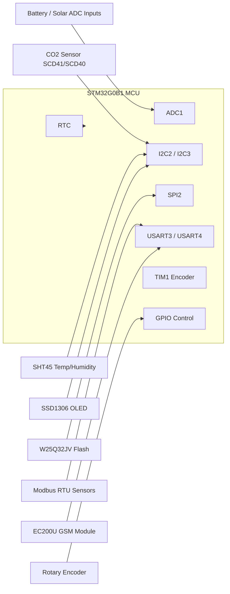
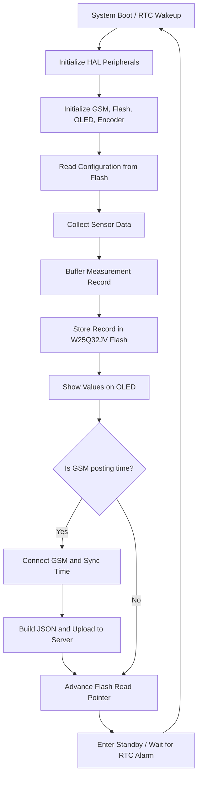

# Sambhav V3 Firmware README

## Overview
Sambhav is an STM32G0-based environmental and soil monitoring node designed for field deployment. The firmware wakes periodically from RTC-driven alarm, reads a wide set of sensors, stores measurements in external flash memory, displays them on an OLED screen, and optionally uploads JSON data to a remote server through a GSM modem.

The system is intended for agriculture and environmental monitoring use cases such as:
- soil moisture and soil temperature monitoring
- nutrient sensing (NPK)
- pH and leaf wetness monitoring
- weather and climate observation
- battery and solar radiation monitoring

---

## Hardware Platform
- MCU: STM32G0B1RETX
- Core peripherals used:
  - ADC1 for analog voltage sensing
  - I2C2 and I2C3 for sensor communication
  - SPI2 for external flash access
  - USART3 for Modbus RTU/RS485 communication
  - USART4 for GSM module communication
  - USART6 for additional serial communication
  - RTC for periodic wake-up and timekeeping
  - TIM1 in encoder mode for the rotary user interface

---

## Sensor and Measurement Details

| Function | Sensor / Interface | Details |
|---|---|---|
| CO2 | SCD41 / SCD40 compatible I2C sensor | Read over I2C at address 0x62 using single-shot measurement commands. Value is stored in ppm. |
| Temperature / Humidity | SHT45 I2C sensor | Read over I2C at address 0x44. The firmware takes multiple samples and uses the median value for stability. |
| Soil nutrient sensing | Modbus RTU sensors | Two NPK channel blocks are polled over RS485/Modbus. Values are decoded into N, P, and K for two soil zones. |
| pH | Modbus RTU pH sensor | Polled over Modbus and converted to a floating-point pH value. |
| Leaf wetness | Modbus RTU leaf wetness sensor | Read as a scaled value and stored as a wetness metric. |
| Soil moisture / temperature / EC | Modbus RTU soil sensing modules | Two independent soil channels are read for moisture, temperature, and electrical conductivity. |
| Weather station | Modbus RTU weather sensor | Reads wind direction, wind speed, air temperature, relative humidity, pressure, rainfall, accumulated rainfall, and solar radiation-related weather values. |
| PAR | Modbus RTU PAR sensor | Reads a photosynthetically active radiation value and scales it before storage. |
| Battery voltage | ADC input | Battery voltage is measured using ADC and converted to an engineering value. |
| Solar radiation | ADC input | A solar sensor voltage is sampled and converted into a radiation estimate. |
| Time and wake timing | RTC | Maintains real time and schedules sampling and posting intervals. |

> Note: Some driver code contains references to SHT21/SHT85-compatible logic and older sensor variants. The current firmware path in the active application uses the SHT45-based acquisition flow. 

---

## Peripheral Summary

### 1. GSM Connectivity
- Module: EC200U
- Communication: UART via USART4
- Functions:
  - power-up and initialization
  - network check
  - time synchronization
  - HTTP data upload
  - optional MQTT support paths are present in the driver layer

### 2. Display
- Display: SSD1306 OLED
- Interface: I2C2
- Purpose:
  - show boot status
  - show measurement values
  - show configuration and error messages

### 3. Data Logging
- Flash memory: W25Q32JV (32 Mbit)
- Interface: SPI2
- Purpose:
  - non-volatile logging of sensor records
  - pending backup storage when GSM upload is unavailable
  - circular/rolling storage management with address mapping

### 4. Communication Bus
- Modbus RTU over RS485
- Physical interface: USART3
- Purpose:
  - polling external soil/weather sensors
  - CRC-checked requests and responses

### 5. User Interface
- Rotary encoder with push button
- Purpose:
  - allow local configuration of sampling interval and GSM posting interval
  - navigate simple menu-based settings

---

## System Architecture
The firmware follows a layered architecture:
1. Hardware abstraction layer via STM32 HAL
2. Sensor drivers for I2C, Modbus, ADC, flash, and GSM
3. Application logic for sensing, logging, display, and communication
4. Low-power scheduling through RTC alarms and standby mode

### Block Diagram

---

## Firmware Overview
On startup, the firmware:
- initializes all MCU peripherals
- initializes the GSM driver and flash interface
- initializes the OLED and encoder UI
- reads stored address-map settings from flash
- starts normal operation on boot or alarm wakeup

During each sampling cycle, the firmware:
- wakes from RTC alarm or boot
- reads environmental, soil, and weather data
- stores the measurement packet in flash
- updates the OLED display
- uploads stored records over GSM when the posting schedule is reached
- returns to low-power standby mode until the next wake event

---

## Firmware Flow Diagram

---

## Data Handling and Storage
- Each measurement cycle creates a binary record containing:
  - timestamp
  - CO2 data
  - temperature and humidity
  - NPK values
  - pH and leaf wetness
  - soil moisture / temperature / EC values
  - weather values
  - battery and solar radiation values
- The record is written to the external flash memory.
- The firmware can later reconstruct a JSON payload from the stored data and transmit it over HTTP.
- If the GSM upload fails, the data remains in flash and can be retried later.

---

## Configuration Notes
The firmware exposes configurable runtime values such as:
- sampling interval (default 15 minutes, configurable in the menu)
- GSM post interval (default 1 hour, configurable in the menu)

Long-press the rotary encoder button for about 3 seconds to enter configuration mode.

| Setting | Variable | Values |
|---|---|---|
| Data collection interval | `time_interval` | 5, 10, 15, 30, 60 minutes |
| GSM upload interval | `GSM_interval` | 1, 2, 3, 4, 6, 12, 24 hours |

These values are stored and restored by the flash-backed configuration logic.

---

## Notes for Development
- The project is organized around STM32 HAL and peripheral-specific drivers in the Core sources.
- The main application loop is centered in the main firmware entry and the sensor acquisition routines.
- The low-power behavior is driven by RTC alarms and standby transitions.
- The firmware is suited for embedded debugging, field testing, and further extension with additional sensors or cloud protocols.
