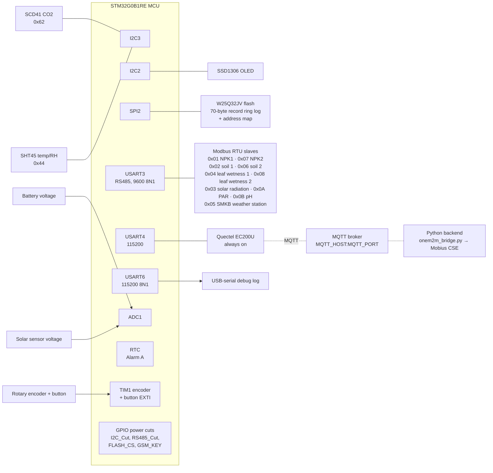
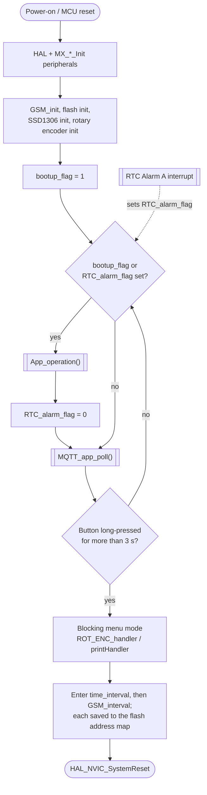
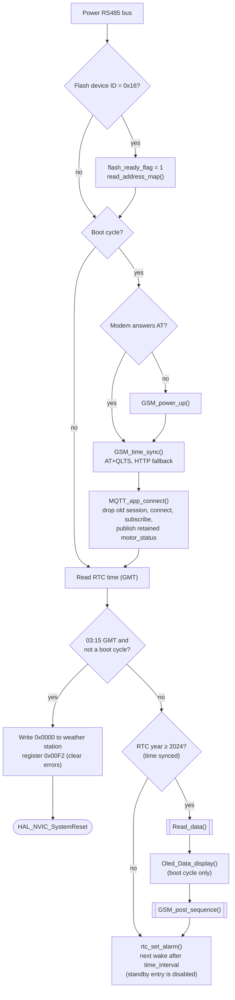
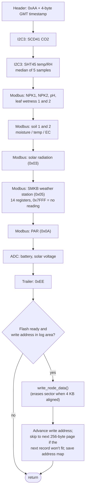
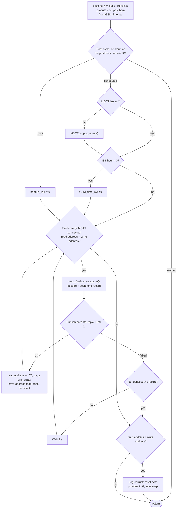
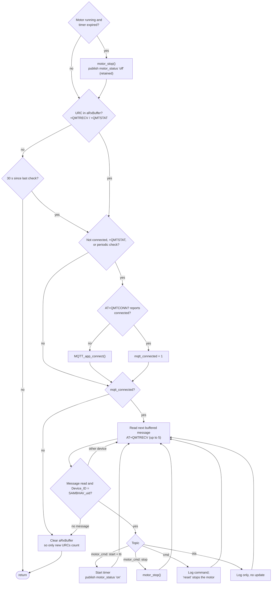

# Sambhav V3 Firmware README

## Overview
Sambhav is an STM32G0-based environmental and soil monitoring node designed for field deployment. On every RTC alarm the firmware reads a wide set of sensors and stores each measurement as a binary record in external flash memory. At the scheduled post hour it publishes the stored records as JSON over MQTT through an always-on GSM modem. Between cycles it listens on MQTT for motor, command and OTA messages from the backend.

The system is intended for agriculture and environmental monitoring use cases such as:
- soil moisture and soil temperature monitoring
- nutrient sensing (NPK)
- pH and leaf wetness monitoring
- weather and climate observation
- battery and solar radiation monitoring

---

## Hardware Platform
- MCU: STM32G0B1RETX
- Core peripherals used:
  - ADC1 for analog voltage sensing
  - I2C3 for the CO2 and temperature/humidity sensors
  - I2C2 for the OLED display
  - SPI2 for external flash access
  - USART3 for Modbus RTU/RS485 communication (9600 8N1)
  - USART4 for GSM module communication (115200)
  - USART6 for the debug log (115200 8N1)
  - RTC for periodic wake-up and timekeeping
  - TIM1 in encoder mode for the rotary user interface

---

## Sensor and Measurement Details

| Function | Sensor / Interface | Details |
|---|---|---|
| CO2 | SCD41 / SCD40 compatible I2C sensor | Read over I2C at address 0x62 using single-shot measurement commands. Value is stored in ppm. |
| Temperature / Humidity | SHT45 I2C sensor | Read over I2C at address 0x44. The firmware takes multiple samples and uses the median value for stability. |
| Soil nutrient sensing | Modbus RTU NPK sensors (slaves 0x01, 0x07) | Two NPK sensors, one per soil zone, each giving N, P and K. |
| pH | Modbus RTU pH sensor (slave 0x0B) | Raw value ÷100. |
| Leaf wetness | Modbus RTU leaf wetness sensors (slaves 0x04, 0x08) | Two sensors, raw value ÷10. |
| Soil moisture / temperature / EC | Modbus RTU soil sensors (slaves 0x02, 0x06) | Two soil channels: moisture ÷100, temperature ÷100, EC as read. |
| Weather station | SMKB weather station, Modbus RTU (slave 0x05) | One 14-register read of signed 16-bit values: air temperature, relative humidity, pressure, rain intensity, accumulated rainfall, wind speed, and wind direction from both the vane and the ultrasonic sensor. `0x7FFF` means "no reading" and is reported as 0. A daily write to register `0x00F2` clears the station's errors. |
| Solar radiation | Dedicated Modbus RTU solar sensor (slave 0x03) | Signed 16-bit value in W/m², sent as the weather `SR` value. |
| PAR | Modbus RTU PAR sensor (slave 0x0A) | Raw value ×3.33. |
| Battery voltage | ADC input | ADC reading converted to battery volts. |
| Solar radiation (analog) | ADC input | A second solar sensor whose voltage is converted to a radiation estimate (0–1500 W/m² over 0.2–3.3 V), sent as the canopy `SR` value. |
| Time and wake timing | RTC | Keeps time in GMT, synced from the GSM network, and schedules sampling and posting. |

> Note: Some driver code contains references to SHT21/SHT85-compatible logic and older sensor variants. The current firmware path in the active application uses the SHT45-based acquisition flow. 

---

## Peripheral Summary

### 1. GSM Connectivity
- Module: EC200U
- Communication: UART via USART4
- The modem stays powered and connected between cycles. After an MCU reset it is only powered up if it doesn't answer `AT`.
- Functions:
  - time synchronization (`AT+QLTS`, with an HTTP fallback)
  - MQTT connection to the broker set in `GSM_EC200U.h`, using `SAMBHAV_<uid>` as the client ID
  - publishes logged sensor records on the `data` topic (QoS 1)
  - publishes the motor state on `motor_status` (QoS 1, retained)
  - subscribes to `motor_cmd`, `cmd` and `ota`; messages addressed to a different `Device_ID` are ignored
- The MQTT topics and payloads are defined by the external Python backend (`device_simulator.py` / `onem2m_bridge.py`, which bridges to a oneM2M Mobius CSE).
- There is no motor hardware yet. "Motor" is a software timer started by `motor_cmd` and run for `tti` × `MQTT_TTI_UNIT_SECONDS`; no GPIO is switched. OTA messages are only logged.
- The earlier HTTP upload path is kept in the source, commented out.

### 2. Display
- Display: SSD1306 OLED
- Interface: I2C2
- Purpose:
  - show boot and cycle status (`Booting....`, `Data Post`, `Sleep`)
  - step through the measured values on the boot cycle
  - show configuration and error messages

### 3. Data Logging
- Flash memory: W25Q32JV (32 Mbit)
- Interface: SPI2
- Purpose:
  - non-volatile log of 70-byte sensor records
  - unsent records stay in flash until they are published successfully, including across resets
  - circular log with persisted write/read pointers and intervals (address map)

### 4. Communication Bus
- Modbus RTU over RS485
- Physical interface: USART3
- Purpose:
  - polling external soil/weather sensors
  - CRC-checked requests and responses

### 5. User Interface
- Rotary encoder with push button
- Purpose:
  - allow local configuration of sampling interval and GSM posting interval
  - navigate simple menu-based settings
- The menu blocks normal operation, including MQTT handling, and ends with an MCU reset after both values are saved.

---

## System Architecture
The firmware follows a layered architecture:
1. Hardware abstraction layer via STM32 HAL
2. Sensor drivers for I2C, Modbus, ADC, flash, and GSM
3. Application logic for sensing, logging, display, and communication
4. Scheduling through RTC alarms. Between cycles the MCU stays running and services MQTT; standby entry is currently disabled.

### Block Diagram

---

## Firmware Overview
On startup, the firmware:
- initializes all MCU peripherals
- initializes the GSM driver and flash interface
- initializes the OLED and encoder UI
- runs a boot cycle, which also powers the modem if needed, syncs time and connects to MQTT

During each sampling cycle (boot, or RTC alarm), the firmware:
- reads the stored address map from flash
- reads environmental, soil, and weather data, once the RTC has a valid time
- stores the measurement record in flash
- shows the values on the OLED (boot cycle only)
- publishes all unsent records over MQTT on boot and at the scheduled post hour
- sets the next RTC alarm

Between cycles the firmware stays in its main loop. It handles incoming MQTT messages, runs the motor timer, and reconnects if the MQTT link drops. Every day at 03:15 GMT (08:45 IST) it clears the weather station's errors and restarts.

---

## Firmware Flow Diagrams

### Main loop (`main()`)
The MCU does not enter standby: it stays in `while(1)`, and the RTC alarm interrupt only sets `RTC_alarm_flag`. Between cycles the loop keeps servicing MQTT.

### Per-cycle sequence (`App_operation()`)

### Sensor acquisition and logging (`Read_data()`)
Raw sensor bytes are packed in this order into the 70-byte record; scaling is applied later, when the record is turned into JSON.

### Data upload (`GSM_post_sequence()`)

### MQTT commands and motor timer (`MQTT_app_poll()`)
There is no motor hardware; the motor is a software timer that runs for `tti` × `MQTT_TTI_UNIT_SECONDS`, with `tti` clamped to 0–255.

---

## Data Handling and Storage
- Each measurement cycle creates a binary record containing:
  - timestamp
  - CO2 data
  - temperature and humidity
  - NPK values
  - pH and leaf wetness
  - soil moisture / temperature / EC values
  - solar radiation and weather station values
  - PAR
  - battery and analog solar ADC values
- Each record is 70 bytes and starts with `0xAA` and ends with `0xEE`. Values are stored as raw sensor counts; scaling is applied when the record is converted to JSON.
- At post time, each unsent record is converted into a JSON payload and published on the MQTT `data` topic.
- The read pointer only advances after a successful publish, so unsent data stays in flash and is retried later. A pass gives up after 5 consecutive failures.
- Changing the record layout makes records already in flash unreadable, so erase the log when deploying a layout change.

---

## Configuration Notes
The firmware exposes configurable runtime values such as:
- sampling interval (default 15 minutes, configurable in the menu)
- GSM post interval (default 1 hour, configurable in the menu)

Long-press the rotary encoder button for about 3 seconds to enter configuration mode.

| Setting | Variable | Values |
|---|---|---|
| Data collection interval | `time_interval` | 5, 10, 15, 30, 60 minutes |
| GSM upload interval | `GSM_interval` | 1, 2, 3, 4, 6, 12, 24 hours |

These values are stored and restored by the flash-backed configuration logic.

---

## Notes for Development
- The project is organized around STM32 HAL and peripheral-specific drivers in the Core sources.
- The main application loop is centered in the main firmware entry and the sensor acquisition routines.
- Sampling is driven by RTC alarms. Standby entry (`HAL_PWR_EnterSTANDBYMode()` in `rtc_sync.c`) is commented out so the modem link and MQTT polling stay active between cycles.
- To trace a cycle, connect a USB-serial adapter to USART6 (115200 8N1). Every stage, sensor value, flash address and outgoing JSON payload is logged there.
- See [CLAUDE.md](CLAUDE.md) for the byte-level record layout, the Modbus map, and the constraints on changing them.
